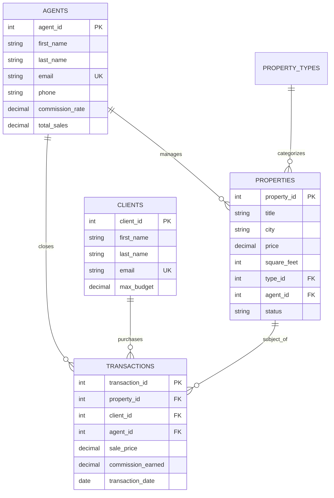

# MySQL-Based Real Estate Management System

[](https://www.mysql.com/)
[](https://react.dev/)
[](https://www.typescriptlang.org/)
[](https://tailwindcss.com/)
[](LICENSE)

A normalized, relational real estate management system built with **MySQL 8** and modern **React / TypeScript**. Designed to manage real estate operations efficiently with normalized tables (3NF), automated triggers, multi-table join views, and agent commission tracking.

---

## 🏛️ Database Architecture & Entity Relationship



---

## ✨ Database Engineering Features

- **Normalized 3NF Relational Tables:** `agents`, `clients`, `property_types`, `properties`, and `transactions` connected via foreign keys and cascade rules.
- **Automated Business Logic Triggers:**
  - `trg_after_transaction_insert`: Automatically toggles property status to `'SOLD'` and increments the agent's total cumulative sales volume whenever a transaction is recorded.
- **Optimized Analytical Views:**
  - `vw_active_properties`: Pre-computed join displaying available property details alongside assigned agent contact information.
  - `vw_agent_performance`: Aggregates closed transactions, total revenue generated, and commissions earned per agent.
- **Interactive Web Interface:** Single-page dashboard built with React 18, TypeScript, and Tailwind CSS to search properties, monitor agent performance, and review schema specifications.

---

## 📂 Project Structure

```
real-estate-management-system-/
├── .github/
│   └── workflows/
│       └── ci.yml                 # GitHub Actions automated build pipeline
├── database/
│   └── schema.sql                 # Complete MySQL schema, tables, triggers, views & seed data
├── src/
│   ├── App.tsx                    # Interactive dashboard & property viewer
│   ├── index.css                  # Tailwind styles
│   └── main.tsx                   # React DOM entry point
├── index.html                     # HTML root
├── package.json                   # Dependencies
├── tsconfig.json                  # TypeScript compiler settings
├── vite.config.ts                 # Vite bundler configuration
└── README.md                      # Documentation
```

---

## 🚀 Getting Started

### 1. Database Setup (MySQL)
Open your MySQL terminal or Workbench and execute:
```sql
SOURCE database/schema.sql;
```

Inspect active views:
```sql
SELECT * FROM vw_active_properties;
SELECT * FROM vw_agent_performance;
```

### 2. Launch Web Interface
```bash
# Install dependencies
npm install

# Start Vite development server
npm run dev

# Build for production
npm run build
```

---

## 📄 License
MIT License.
